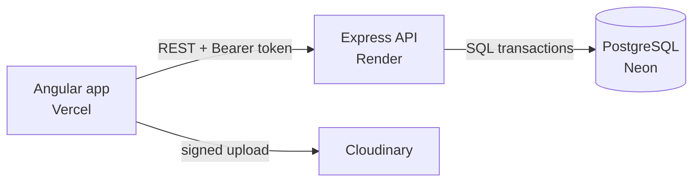

# OliviaBakes

A full-stack online bakery. Customers order cookies for a chosen delivery day, and the owner runs everything from an admin portal.

**Live demo:** https://olivia-bakes.vercel.app/

## Stack

| Layer | Tech |
|---|---|
| Frontend | Angular 19 (standalone components, signals), TypeScript |
| Backend | Node.js, Express, node-postgres |
| Database | PostgreSQL on Neon |
| Media | Cloudinary (signed uploads) |
| Hosting | Vercel · Render · Neon |

## Architecture



## Features

**Customers**
- Sign up, log in, reset password
- Typo-tolerant search, item details (ingredients, allergens, weight), favourites
- Saved addresses, calendar-based delivery slots, order tracking by private link
- Custom cake requests with an owner quote

**Admin portal**
- Role-protected sidebar: active orders (paid or unpaid), custom requests, daily capacity, items, offers
- Quote, reschedule or decline custom cakes
- Per-item daily limits, stock counts, item CRUD with photo upload

## Run locally

```bash
# backend (needs Node 20+)
cd backend && npm install
npm run dev            # http://localhost:3000

# frontend
cd frontend && npm install
npm start              # http://localhost:4200

# optional fake users and orders
cd backend && node --env-file=.env seed-demo.js
```

`backend/.env`:

| Variable | Purpose |
|---|---|
| `DATABASE_URL` | PostgreSQL connection string |
| `JWT_SECRET` | token signing key |
| `ADMIN_EMAIL`, `ADMIN_PASSWORD` | creates the admin account on first start |
| `CLOUDINARY_CLOUD_NAME`, `CLOUDINARY_API_KEY`, `CLOUDINARY_API_SECRET` | image uploads |
| `APP_URL`, `CORS_ORIGIN` | frontend address, for reset links and CORS |

## Deploy

Neon (database) → Render (root `backend`, start `npm start`) → Vercel (root `frontend`, output `dist/web/browser`).

## Next

Online UPI payments · emailed reset links through an HTTPS email API · automated tests
